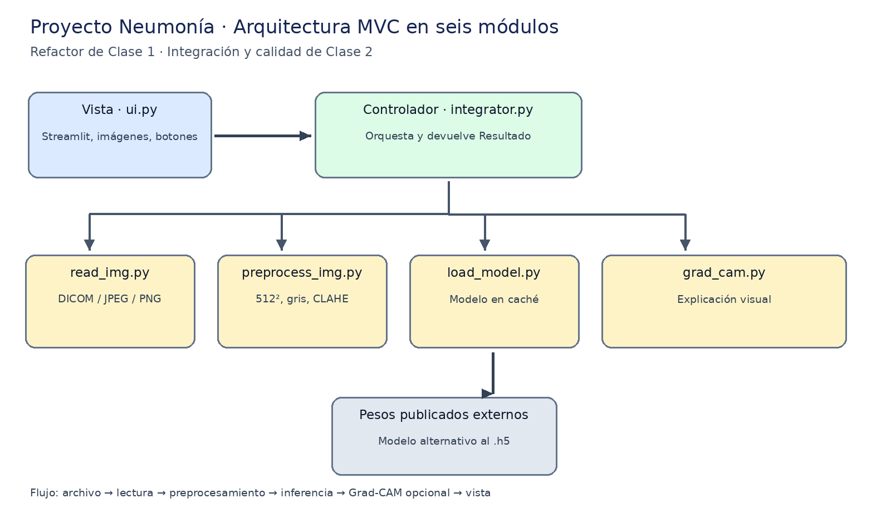
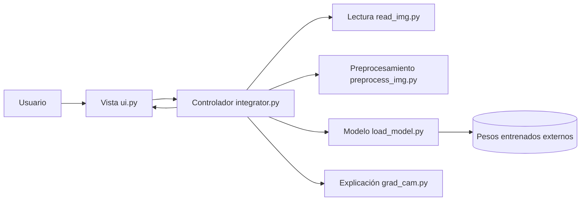

# Documento de diseño — Proyecto Neumonía

**Proyecto:** Desarrollo de Proyectos de Inteligencia Artificial, UAO · Módulo 1  
**Fuente del diseño:** Clase 1, diapositivas 11–12, 24–29; Clase 2, diapositivas 35–49.

## Objetivo funcional

La aplicación permite cargar una radiografía de tórax DICOM/JPEG/PNG, visualizarla,
clasificarla experimentalmente como normal, neumonía bacteriana o viral y mostrar,
si es posible, un mapa Grad-CAM. **No es una herramienta médica de diagnóstico.**

## Patrón MVC y seis módulos

| Componente | Archivo | Responsabilidad única |
| --- | --- | --- |
| Modelo: lectura | `src/neumonia/read_img.py` | Validar y decodificar DICOM, JPEG y PNG |
| Modelo: preparación | `src/neumonia/preprocess_img.py` | Gris, CLAHE, 512×512, rango [0,1] |
| Modelo: pesos | `src/neumonia/load_model.py` | Obtener/cachear una vez el modelo alternativo |
| Modelo: explicación | `src/neumonia/grad_cam.py` | Atribución y mapa de calor |
| Controlador | `src/neumonia/integrator.py` | Orquestar el flujo y devolver resultados |
| Vista | `src/neumonia/ui.py` | Presentar entradas, imágenes, respuestas y errores |

`app.py` solo inicia la vista. La **vista únicamente importa el integrador** del
proyecto (además de Streamlit): no maneja los tensores ni sabe qué motor realiza
la inferencia.

## Diagrama de componentes

## Contratos de los módulos

- `cargar_imagen(bytes, nombre)` devuelve una imagen Pillow RGB o lanza `ImagenInvalida`.
- `preprocess_image(imagen)` devuelve `np.ndarray` de forma `(1,512,512,1)`,
  `float32`, valores en `[0,1]`.
- `cargar_modelo()` devuelve la instancia en caché; requiere pesos descargados.
- `predecir(imagen, generar_mapa)` produce `Resultado` tipado.
- `analizar_imagen(imagen, generar_mapa, motor)` permite inyectar un motor falso
  para probar el controlador sin red neuronal ni internet (DIP).
- `superponer_mapa(imagen, heatmap)` devuelve Pillow RGB con dimensiones originales.

## Flujo de datos real

1. UI recibe bytes del archivo y el controlador delega la lectura.
2. La imagen se muestra sin preprocesamiento destructivo.
3. `integrator.predecir` ejecuta el pipeline 512×512, gris, CLAHE, [0,1].
4. Se adapta el tensor a 224×224 RGB normalizado para el **modelo alternativo**.
5. Se calculan las puntuaciones softmax de tres clases.
6. Grad-CAM opcional se superpone a la imagen original; la UI muestra ambos.

**Limitación importante:** el pipeline 512×512/CLAHE imita el diseño académico,
pero no equivale al preprocesamiento usado para entrenar ConvNeXtV2 en el modelo
alternativo. Por lo tanto, **no se ha validado su precisión con este pipeline**.
El proyecto original menciona modelos `.h5` no disponibles en el fork inicial;
si el profesor proporciona esos pesos, se debe adaptar `load_model.py` y
`integrator.py` a su contrato real.

## Principios de ingeniería

- **SRP:** cada módulo tiene una única razón para cambiar.
- **OCP:** nuevos loaders se agregan sin cambiar la lógica de inferencia.
- **DIP:** controlador acepta motor inyectado; tests reemplazan la red neuronal.
- **Alta cohesión y bajo acoplamiento:** cambios visuales no tocan inferencia;
  cambiar el motor no cambia la vista.
- **Reproducibilidad:** `pyproject.toml`, `.python-version`, Docker, `uv`;
  se debe generar/versionar `uv.lock` antes de finalizar la entrega.
- **Seguridad:** no se suben radiografías, pesos, secretos ni datos de pacientes.

## Pruebas y validación

`tests/` contiene pruebas de formatos admitidos, archivos corruptos, escala,
forma, tipo, normalización, probabilidades, inyección y Grad-CAM.

- `uv run pytest -q`: pruebas unitarias sin peso del modelo.
- `uv run ruff check .`: lint.
- `uv run ruff format --check .`: formato.
- `make check`: lint + formato + pruebas con warnings como errores.

Las pruebas unitarias **no prueban** precisión del modelo, descarga de pesos,
ni la compilación del contenedor. Estos aspectos se verifican manualmente.
